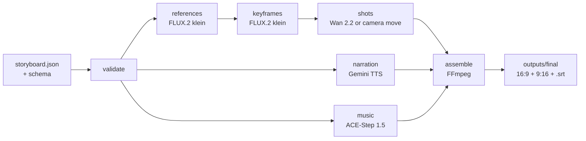

# ARCHITECTURE.md

How `storyboard.json` becomes the film, and why it is built this way.

## The idea in one paragraph

One file, `storyboard.json`, describes the whole film: characters, style, every shot (prompts, seed, length, camera move, crop), the narration line in Tigrigna and English, and the music cues. It is validated against a JSON Schema before anything runs. Each stage reads the storyboard, writes its outputs, and names every output file after a hash of its inputs. A re-run therefore only calls a model for what changed, and changing one shot regenerates only that shot.

## Stages

| Stage | Module | Model / tool | Runs on | Writes | Cache key (file name hash) |
|---|---|---|---|---|---|
| Validate | `pipeline/validate.py` | JSON Schema + cross-field checks | local | nothing; stops on errors | none |
| References | `pipeline/references.py` | FLUX.2 klein 4B | Cloudflare Workers AI | `outputs/references/` portrait options | model, size, steps, seed, prompt |
| Keyframes | `pipeline/keyframes.py` | FLUX.2 klein 4B | Cloudflare Workers AI | `outputs/keyframes/` | prompt, seed, size, steps and the contents of every input image |
| Shots | `pipeline/shots.py`, `pipeline/wan.py`, `notebooks/wan_shots.py` | Wan 2.2 TI2V-5B, else an FFmpeg camera move | Kaggle 2× T4 / local | `outputs/shots/` | keyframe contents, prompt, settings |
| Narration | `pipeline/narration.py` | Gemini TTS (`gemini-3.8-flash-tts`, voice Sulafat) | Google AI Studio | `outputs/narration/` | model, voice, text |
| Music | `pipeline/music.py`, `notebooks/music_cues.py` | ACE-Step 1.5 turbo | Kaggle T4 | `outputs/music/` | cue, seeds; the author's `chosen` candidate |
| Assemble | `pipeline/assemble.py` | FFmpeg | local | `outputs/final/` | always re-run (about 75 s) |

There is no separate script stage. The story and the narration were written with the author from family recollection (DESIGN.md), not generated, and they live in `storyboard.json`.

## Decisions worth knowing

**The storyboard is the only place prompts, seeds and settings live.** No prompt is hidden in code. Each stage reads it through `load_storyboard()`, which refuses an invalid file, so a typo stops the run before it costs a model call.

**Where each setting lives.** Everything that shapes the film is in `storyboard.json`: models, sizes, steps, voice, prompts, seeds, crops, music cues, and the `edit` (lead-in, tail, crossfade, camera-move zoom) and `mix` (loudness target, music bed level, ducking) blocks. `.env` holds only what must not be committed or only changes how the pipeline runs on one machine: API keys, and the optional `TTS_PACE_S` and `KAGGLE_ACCELERATOR`. So two people with the same storyboard get the same film, whatever their `.env` says.

**Caching by input hash.** A file like `s04_846bae35.jpg` is named after everything that produced it. If the file exists, the stage skips the call. This makes re-runs free and the walkthrough's "change one shot, regenerate only that shot" automatic. It also replaces exact seeds, which Cloudflare's klein does not honour (EXPERIMENTS.md E03).

**Consistency comes from references, in two steps.** Approved portraits of the brothers are the golden references. Each keyframe is made first from text (setting, people, poses), then edited so the brothers match their portraits. Close-ups use a head-and-shoulders crop so the full-length pose is not copied (EXPERIMENTS.md E04).

**Narration sets the cut.** Assembly lengthens a shot when its Tigrigna line is longer than planned, so words and picture stay together. The total is checked against 60–90 s.

**Square masters, two crops.** Keyframes and clips are square. Assembly cuts 16:9 and 9:16 from the same material, with a per-shot `crop` position in the storyboard to keep the subject in frame.

**Sound.** Narration lines are placed on the timeline, the score is ducked under the voice with a sidechain compressor, and the mix is normalised in two passes to −14 LUFS (−1 dBTP). English subtitles are burned in, a sidecar `.srt` is kept, and the AI end card closes the film.

**GPU work runs on Kaggle, started from here.** `pipeline/wan.py` and `pipeline/music.py` upload the inputs as a private dataset or inline job, start a private notebook on 2× T4, and `pull` the results into `outputs/` with a line per clip in `runs.jsonl`. Notebooks save each output as soon as it is done, because sessions can time out. Wan does not fit on one 16 GB T4, so the text encoder runs on the second GPU (FAILURES.md F05). If a clip fails or is missing, the shot falls back to the storyboard's camera move, so the film always builds.

## Reliability and safety

- **One log line per model call** in `runs.jsonl`: time, stage, model, parameters, seed, attempt, latency, cost, status, output and error. `pipeline/costs.py` turns it into COSTS.md.
- **Retries with backoff** (`pipeline/common.py`). If the provider says the quota is gone for longer than a minute, the run stops at once instead of wasting requests, and keeps what it already made (FAILURES.md F03).
- **Secrets** stay in `.env`, which is git-ignored, with names only in `.env.example`. A key is asked for only when a call is actually needed, so a fresh clone rebuilds the committed film with no keys.
- **Limits are checked before sending:** the prompt length (2048 characters on Workers AI), subtitle length, shot count and total running time.

## Regenerating one shot (the walkthrough demo)

1. Change one shot's `image_prompt` (or one narration line) in `storyboard.json`.
2. `make keyframes`: only that shot's scene and identity images are new; the other ten print `cached`.
3. `make wan SHOTS=<id>` and `uv run python -m pipeline.wan pull` for a new clip, or skip this and the shot uses its camera move.
4. `make film`: the shot's clip is rebuilt and the film re-assembled.
